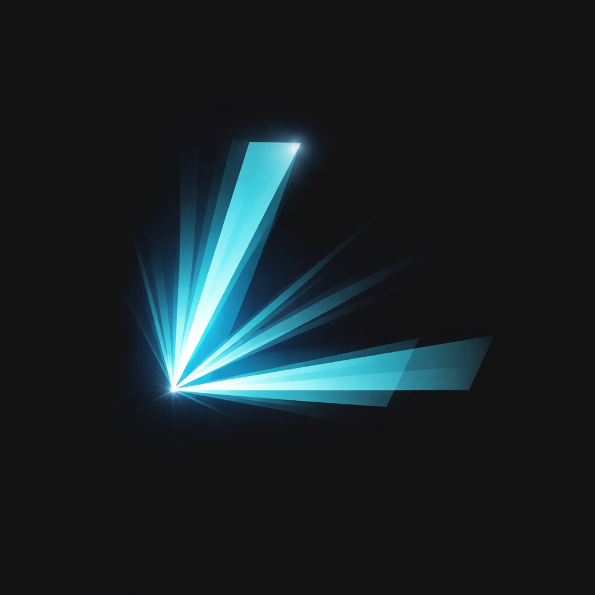

<p align="center">
  
</p>

<h1 align="center">Luma</h1>

<p align="center">
  <a href="https://github.com/julianallchin/luma/actions/workflows/ci.yml">
    
  </a>
</p>

Procedural lighting control for portable light shows that work across any venue. Traditional lighting consoles record hardware-specific DMX instructions that break when you change venues. Luma records *intent* — patterns that automatically adapt to whatever fixtures are in the room.

Think of it like sheet music vs. a recording. Sheet music says "play a C major chord" and works on any instrument. Luma says "red circular pulse" and works on any rig.

## Documentation

- **[User Guide](https://luma.show/docs/user-guide/why-luma)** — How Luma works, the full workflow from venue setup to live performance
- **[Architecture](https://luma.show/docs/architecture/overview)** — Node graph engine, compositor, DMX pipeline, fixture system, database, design decisions
- **[Node Reference](https://luma.show/docs/node-reference)** — Pattern graph nodes, one page per category

## The Workflow

1. **Define your venue** — Patch fixtures, set 3D positions and rotations
2. **Tag groups** — Organize fixtures into groups with tags (`left`, `circular`, `wash`)
3. **Import tracks** — From Engine DJ or audio files; auto-analyzes beats, stems, chords
4. **Define patterns** — Visual node graphs that generate lighting from audio/beat data
5. **Annotate tracks** — Place patterns on a timeline with layering and blend modes
6. **Perform** — Follow a DJ (Rekordbox, Pro DJ Link or StageLinQ), play live patterns from pads and faders, bind MIDI and OSC, and output Art-Net or USB DMX

## Project Structure

- **`gpui/`** — Native Rust desktop UI and wgpu stage renderer
- **`backend/`** — Shared Rust backend (SQLite, node engine, audio DSP, ArtNet)
- **`www/`** — Documentation site ([luma.show](https://luma.show))
- **`resources/fixtures/`** — QLC+ fixture definition library (thousands of fixtures)
- **`harness/`** — Renderer goldens, reference captures and image comparison tools (`cd harness && bun install`)
- **`experiments/powersync/`** — A disposable Postgres, PostgREST and PowerSync stack for the sync tests
- **`scripts/`** — Setup, release bundling, headless agent tools (`scripts/headless/`) and a library backup (`scripts/library/snapshot.py`)
- **`deploy/`**, **`supabase/`** — The sync service's rules and the server's migrations

## Getting Started

You need [rustup](https://rust-lang.org/tools/install/),
[Git LFS](https://git-lfs.com), Python 3, and on macOS Xcode (the Metal shader
compiler). Linux needs a few system libraries; see
[gpui/BUILD.md](gpui/BUILD.md#linux-system-libraries).

```sh
git clone git@github.com:julianallchin/luma.git   # SSH: the one submodule is SSH too
cd luma
scripts/setup              # toolchain, submodule, LFS files, git hooks; checks the rest
python3 gpui/dev.py        # build, launch, and rebuild on save
```

`rust-toolchain.toml` pins Rust 1.97.1 for the whole repository, so plain
`cargo` works from anywhere inside it. Without the watcher:
`cargo run --manifest-path gpui/Cargo.toml -p luma-app`.

The first build downloads a bundled Python 3.12 runtime and ffmpeg into
`backend/`. At first launch the app creates the Python environment for the
analysis workers (beats, stems, chords) in the background.

## Tests

Run from the repository root:

| What | Command |
|---|---|
| Native app, compile everything | `cargo check --manifest-path gpui/Cargo.toml --workspace --all-targets` |
| Backend (library, bins, crates) | `cargo test --manifest-path backend/Cargo.toml --workspace` |
| UI script tests (`*.test.js`) | `gpui/test` (see [gpui/BUILD.md](gpui/BUILD.md#script-tests-gpuitest)) |
| One native crate | `cargo test --manifest-path gpui/Cargo.toml -p luma-render` |
| Agent Python executor | `python3 backend/python/luma_exec/tests/run_tests.py` |
| Sync against a live stack (Docker) | `python3 experiments/powersync/run.py --test sync::two_device_tests` |

A golden test fails when its file is stale and never rewrites it; regenerate
with `LUMA_UPDATE_GOLDENS=1`, review the diff and commit it. CI
(`.github/workflows/ci.yml`) runs the first two rows, the Python suite, and
some native crates.

## Where to read next

- [AGENTS.md](AGENTS.md) — conventions: code philosophy, migrations, tests, UI style
- [gpui/BUILD.md](gpui/BUILD.md) — build profiles, target directories, the test harness
- [backend/README.md](backend/README.md) — the backend's layout
- [docs/specs/](docs/specs) and [docs/design/](docs/design) — how each system is meant to work; [docs/design/sync.md](docs/design/sync.md) for sync
- [deploy/README.md](deploy/README.md) — deploying Supabase and PowerSync
- [RELEASING.md](RELEASING.md) — tagging a release and the nightly build
