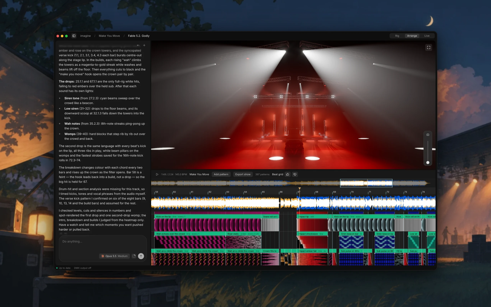

# Luma

Lighting control that records a show's intent, so one show plays on any rig in any venue.



A console records DMX for one room's fixtures. Luma records patterns aimed at
named groups (`front_wash`, `back_movers`), and each venue says which of its
fixtures those groups hold. Build the rig, arrange a score on a song's
timeline, and play it live along with a DJ.

## Download

Get the latest release for Apple silicon Macs or Linux x86_64 from
[GitHub Releases](https://github.com/lumashow/luma/releases/latest). An
installed app updates itself.

## Build from source

You need [rustup](https://rust-lang.org/tools/install/),
[Git LFS](https://git-lfs.com), Python 3, and Xcode on macOS.

```sh
git clone git@github.com:lumashow/luma.git
cd luma
scripts/setup          # toolchain, submodule, LFS files, git hooks
python3 gpui/dev.py    # build, launch, and rebuild on save
```

[gpui/BUILD.md](gpui/BUILD.md) has the rest: Linux libraries, build
profiles, and the test harness.

## Docs

- [luma.show/docs](https://luma.show/docs/user-guide/why-luma): the user
  guide, the [architecture](https://luma.show/docs/architecture/overview) and
  the [node reference](https://luma.show/docs/node-reference)
- [AGENTS.md](AGENTS.md): the conventions for working in this repository
- [docs/README.md](docs/README.md): how each system works
- [RELEASING.md](RELEASING.md): releases and the nightly build

## Tests

Run from the repository root:

| What | Command |
|---|---|
| Native app, compile everything | `cargo check --manifest-path gpui/Cargo.toml --workspace --all-targets` |
| Backend (library, bins, crates) | `cargo test --manifest-path backend/Cargo.toml --workspace` |
| UI script tests (`*.test.js`) | `gpui/test` (see [gpui/BUILD.md](gpui/BUILD.md#script-tests-gpuitest)) |
| One native crate | `cargo test --manifest-path gpui/Cargo.toml -p luma-render` |
| Agent Python executor | `python3 backend/python/luma_exec/tests/run_tests.py` |
| Analysis workers (Python) | `python3 -m unittest discover -s backend/python/tests` |
| Release scripts (Python) | `python3 -m unittest discover -s scripts/release` |
| Sync against a live stack (Docker) | `python3 deploy/test-stack/run.py --test sync::two_device_tests` |

## License

[PolyForm Shield 1.0.0](LICENSE.md).
